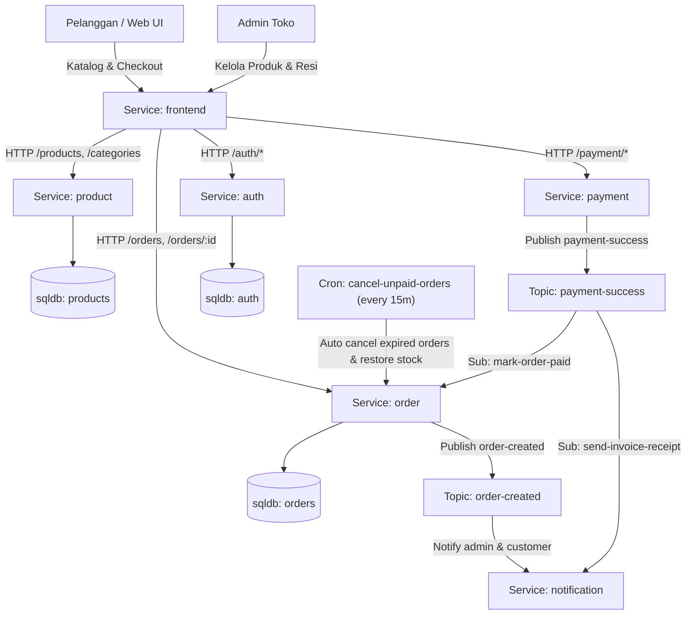

# Supatman Online Store (Physical & Digital E-Commerce)

Aplikasi Toko Online Pribadi Full-Stack berbasis **Microservices & Event-Driven Architecture (EDA)** menggunakan framework **[Encore.dev](https://encore.dev)** (Go) dan **React 18 + Tailwind CSS**.

Mendukung penjualan **Barang Fisik** (perhitungan ongkir flat & alamat ekspedisi) serta **Produk Digital** (e-book, software license, template design dengan akses unduhan instan saat lunas).

---

## Arsitektur & CodeGraph



---

## Fitur Utama

1. **Multi-Domain Products**:
   - Mendukung produk fisik (stok finite, input alamat pengiriman, nomor resi pengiriman).
   - Mendukung produk digital (stok unlimited, link download/akses file instan yang otomatis terbuka setelah pembayaran terverifikasi).
2. **Multi-Payment Ready**:
   - **Transfer Bank Manual** (BCA & Mandiri) lengkap dengan fitur unggah bukti transfer.
   - **QRIS Static** (Scan barcode instan).
   - **Duitku Payment Gateway (POP)** (Virtual Account BCA/Mandiri/BNI/BRI, QRIS, E-Wallet, Kartu Kredit).
3. **Event-Driven Pub/Sub**:
   - Topik `order-created`: memicu notifikasi pesanan baru secara asinkron.
   - Topik `payment-success`: otomatis meng-update status pesanan menjadi `paid` dan membuka akses download digital.
4. **Auto-Cancellation Cron Job**:
   - Setiap 15 menit, cron memeriksa pesanan yang belum dibayar selama 24 jam untuk otomatis dibatalkan dan mengembalikan stok produk fisik.
5. **Autentikasi & Role Management**:
   - Registrasi dan login pelanggan & admin menggunakan bcrypt hashing dan Encore auth token handler.
   - Portal Admin terintegrasi untuk menambah produk, verifikasi bukti bayar manual, dan input nomor resi pengiriman.
6. **Frontend Modern (React + Tailwind)**:
   - Tampilan gelap (*sleek dark glassmorphism*) dengan tipografi Plus Jakarta Sans.
   - Drawer keranjang belanja mengambang, filter produk instan, pencarian, dan pelacakan pesanan digital.

---

## Struktur Direktori

```
encore/
├── encore.app                 — Konfigurasi Encore Application
├── go.mod / go.sum            — Dependensi Go (encore.dev v1.57, bcrypt, pgx)
├── auth/                      — Layanan registrasi, login, token auth handler
│   ├── auth.go
│   └── migrations/            — Tabel 'users'
├── product/                   — Layanan katalog produk & kategori
│   ├── product.go
│   └── migrations/            — Tabel 'categories' & 'products' (dengan seed data)
├── order/                     — Layanan keranjang belanja, checkout, dan cron pembatalan
│   ├── order.go
│   └── migrations/            — Tabel 'orders' & 'order_items'
├── payment/                   — Layanan pembayaran (Transfer Bank, QRIS, Duitku POP)
│   └── payment.go
├── notification/              — Layanan notifikasi event-driven (Telegram/WhatsApp/Log)
│   └── notification.go
└── frontend/                  — SPA UI (React 18 + Tailwind CSS + Vite)
    ├── frontend.go            — Go embed.FS handler menyajikan aset web
    ├── src/
    │   ├── App.tsx            — Komponen utama antarmuka toko online
    │   ├── api.ts             — Client API terstruktur untuk seluruh endpoint Encore
    │   └── index.css          — Styling design tokens & typography
    └── dist/                  — Hasil build bundle produksi
```

---

## Cara Menjalankan

### 1. Prasyarat
- **Docker** aktif di komputer Anda.
- **Encore CLI** terpasang (`curl -L https://encore.dev/install.sh | bash`).

### 2. Jalankan Backend & Frontend
Jalankan perintah berikut di root direktori proyek:

```bash
encore run
```

Encore akan secara otomatis:
- Menyiapkan cluster database PostgreSQL lokal di Docker.
- Menjalankan migrasi schema dan initial seed produk secara otomatis.
- Mengompilasi seluruh service dan menyajikan backend API serta web frontend.

### 3. Akses Antarmuka
- **Website Toko Online**: [http://localhost:4000/](http://localhost:4000/)
- **Encore Local Developer Dashboard**: [http://localhost:9400/](http://localhost:9400/) *(untuk melihat visualisasi CodeGraph interaktif, trace request, dan service catalog)*.

---

## Akun Demo & Akses Admin
- **Mendaftar Admin**: Buka menu **Masuk** $\rightarrow$ **Daftar**, lalu isi field *Kode Rahasia Admin* dengan: `admin123`.
- Setelah login sebagai admin, tombol **Admin Panel** akan muncul di bar navigasi atas untuk menambah produk dan memverifikasi pembayaran.
